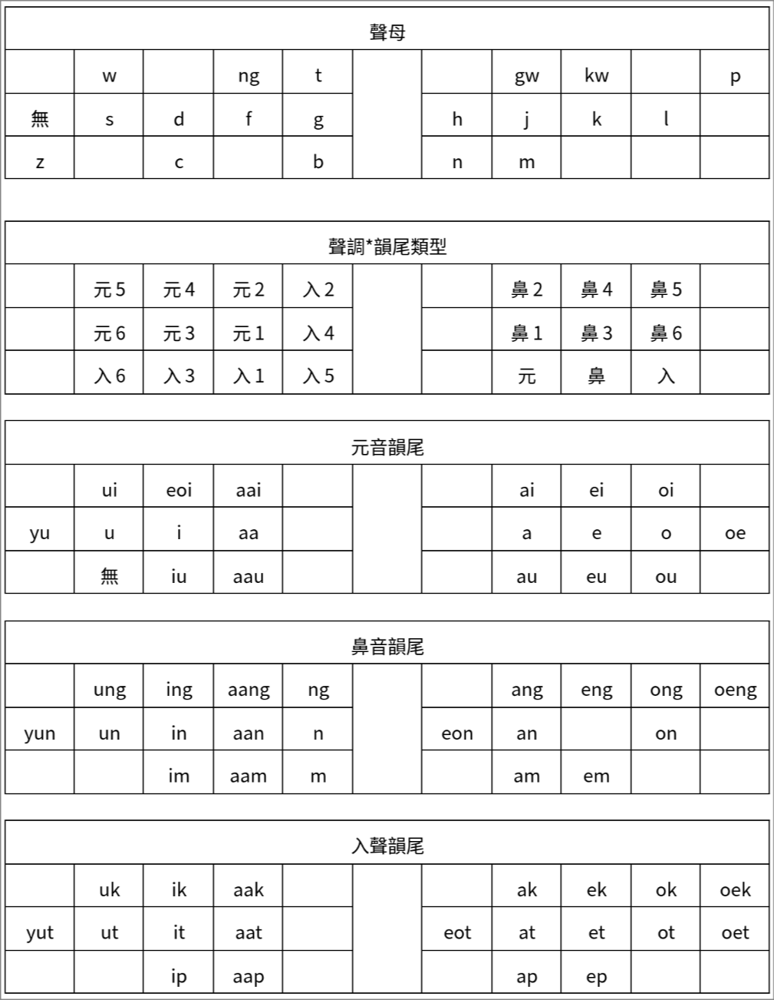

# 粵語三拼

配方： ℞ **triple_jyutping**

[Rime](https://rime.im/) 粵語三拼輸入方案

## 安裝

本方案依賴於
- [粵語拼音](https://github.com/rime/rime-cantonese)

[東風破](https://github.com/rime/plum) 安裝口令： `bash rime-install chenlin014/rime-triple-jyutping:full cantonese`

安裝默認配置： `bash rime-install chenlin014/rime-triple-jyutping:default_config`

## 默認布局

